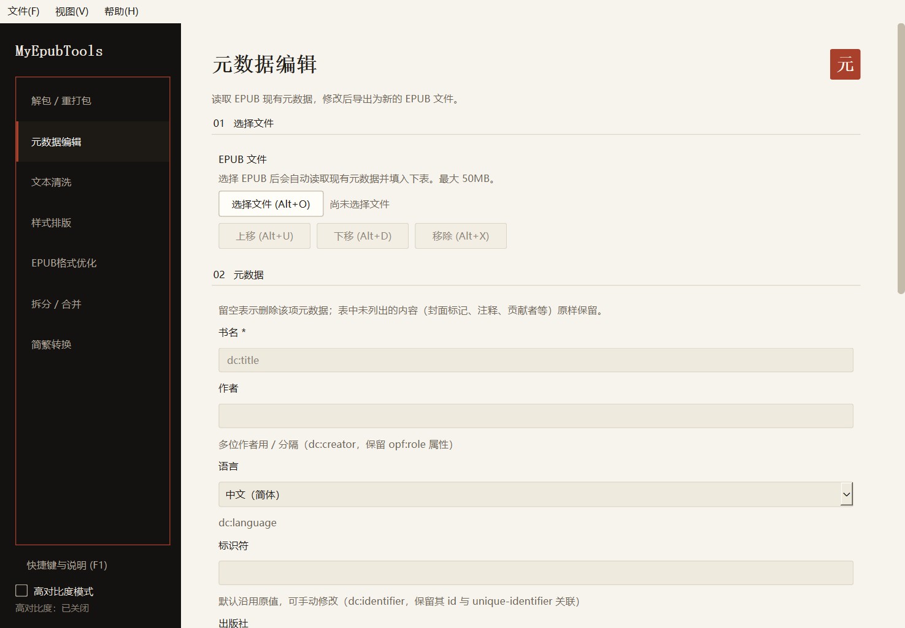
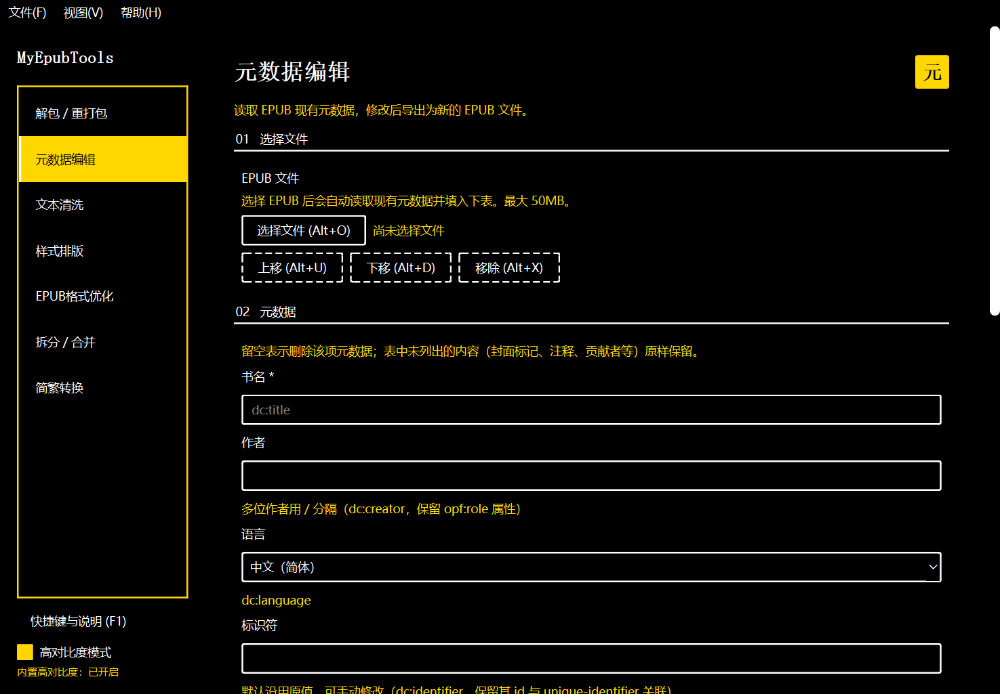
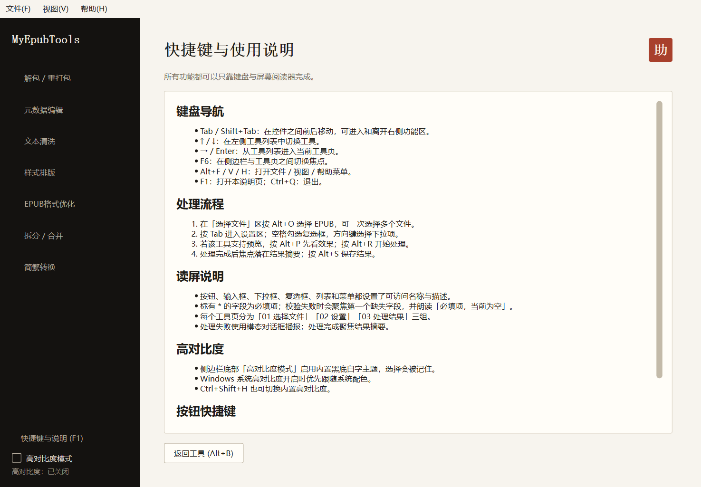

# MyEpubTools · 视障友好桌面版

MyEpubTools 是一个面向 Windows 的 EPUB 桌面工具箱（PyQt6），提供解包 / 重打包、元数据编辑、文本清洗、样式排版、格式优化、拆分 / 合并、简繁转换 7 个工具，并按《Windows 应用无障碍可访问性开发指南》完成屏幕阅读器语义、键盘导航与高对比度适配。



## 功能一览

| 工具 | 说明 |
| --- | --- |
| **解包 / 重打包** | EPUB 解包成 ZIP 查看内部结构，或把 ZIP 重新打包成规范 EPUB |
| **元数据编辑** | 读取并修改书名、作者、语言、标识符与出版信息，另存为新文件 |
| **文本清洗** | 按 spine 清洗正文：规范空白、合并断行、清理冗余内联标签、自定义查找替换；支持批量 |
| **样式排版** | 安全清理样式表与正文空段，并统一行距、缩进等排版参数 |
| **EPUB格式优化** | 就地改写 `<p>` 样式以删除段间空行；支持追加紧凑化规则或替换模板样式；支持批量 |
| **拆分 / 合并** | 从一本书里抽出选中章节另存为新书，或多本按顺序合并成一本 |
| **简繁转换** | 简体与繁体互转，可选覆盖正文、目录导航与元数据；支持批量 |

## 无障碍特性

### 1. 屏幕阅读器可识别、可朗读

- 7 个工具页共 **112 个可交互控件**全部设置可访问名称与描述；角色（按钮 / 输入框 / 下拉框 / 复选框 / 列表）与状态（勾选 / 选中 / 禁用 / 聚焦）由 Qt `QAccessible` 原生暴露。
- 分组标题与可见章节标题一致：`01 选择文件`、`02 元数据`、`03 处理结果`。
- 必填字段显示 `*`，可访问名称为「书名（必填）」；校验失败自动聚焦第一个缺失字段，并朗读「必填项，当前为空」，输入后描述自动还原。
- 动态标签（状态、已选文件数、上传说明）直接以实际文字作为可访问名称，避免读屏只读「状态」这类泛化词。
- 工具列表项使用标题作为可访问文本、描述作为 `AccessibleDescriptionRole`。
- 装饰性印章标注为「装饰性印章 / 仅装饰，无操作」，不进入焦点链。

### 2. 全键盘操作与可感知焦点

| 按键 | 作用 |
| --- | --- |
| `Tab` / `Shift+Tab` | 控件间前后移动，可进出右侧功能区 |
| `↑` / `↓` | 在左侧工具列表切换工具 |
| `→` / `Enter` | 从工具列表进入当前工具页 |
| `F6` | 在侧边栏与工具页之间切换焦点 |
| `Alt+F` / `V` / `H` | 文件 / 视图 / 帮助菜单 |
| `Alt+O` / `B` / `L` / `P` / `R` / `S` | 选择文件 / 浏览 / 读取 / 预览 / 开始处理 / 保存结果 |
| `Alt+U` / `D` / `X` | 上移 / 下移 / 移除 |
| `Alt+A` / `C` | 全选 / 清空 |
| `Ctrl+Shift+H` | 切换内置高对比度 |
| `F1` | 打开应用内「快捷键与使用说明」页 |
| `Ctrl+Q` | 退出 |

- 焦点链显式串联：`工具列表 → 快捷键与说明 → 高对比度开关 → 当前页首控件 → … → 末控件 → 工具列表`。
- 所有按钮在文字后直接标出快捷键，并用**窗口级 `QShortcut`** 注册；页面隐藏时自动禁用，避免误触。
- 焦点进入折叠区时自动滚动到该控件；列表、按钮均有高对比度焦点边框。

### 3. 高对比度

- **系统高对比度优先**：Windows 开启高对比度时清空自带样式表，完全跟随系统调色板。
- **内置高对比度**：侧边栏「高对比度模式」或 `Ctrl+Shift+H` 启用纯黑底、纯白字、明黄强调的主题；选择通过 `QSettings` 记住。
- 内置主题不使用中间灰，禁用态用虚线边框，焦点框 2–3px。



### 4. 功能完整、不中断

- 耗时处理在 `QThread` 中执行，界面不卡死。
- 处理完成聚焦结果摘要；错误使用模态对话框播报。
- 业务逻辑与界面解耦，7 个工具均可完整运行，处理结果可正常保存。

### 5. 应用内帮助页

按 `F1`、点击侧边栏「快捷键与说明 (F1)」或帮助菜单，会切换到常驻帮助页，内容包括键盘导航、处理流程、读屏说明、高对比度与按钮快捷键。



## 环境要求

- Windows 10 / 11
- Python 3.10–3.12（推荐 3.12；本项目在 3.12.8 + PyQt6 6.12.0 验证）
- 依赖见 `requirements.txt`

> Flask / Werkzeug 是业务层的依赖（模块中使用 `Blueprint / request / url_for`）；本程序只调用其数据处理函数，不会启动网络服务。

## 运行

### 双击启动

双击仓库根目录的 `启动.bat`。首次运行会自动创建 `.venv` 并安装依赖（约 1–2 分钟）；之后双击直接启动。

> `.venv` 由脚本自动创建，`.gitignore` 已忽略，不需要提交。
> 启动后会保留一个命令行窗口，最小化即可；关闭它会退出程序。
> 如果双击后窗口一闪而过，请在仓库根目录打开终端运行 `.\启动.bat` 查看完整错误。

### 手动运行

以下命令均在仓库根目录执行：

```powershell
python -m venv .venv
.venv\Scripts\python.exe -m pip install -r requirements.txt
.venv\Scripts\python.exe -m desktop.main
```

自检（启动 1.2 秒后自动退出）：

```powershell
.venv\Scripts\python.exe -m desktop.main --smoke
```

## 使用流程

1. 左侧选择工具（`↑`/`↓`，或鼠标点击）。
2. 按 `Alt+O` 选择 EPUB（可多选）。
3. `Tab` 进入设置区，按需填写 / 勾选。
4. `Alt+R` 开始处理；完成后焦点落在结果摘要。
5. `Alt+S` 保存结果。
6. 随时按 `F1` 查看完整快捷键与读屏说明。

`sample_test.epub` 同时是「EPUB 格式优化 → 替换模板样式」的默认模板，请保留在仓库根目录。

## 项目结构

```
myepubtools-a11y/
├─ desktop/
│  ├─ main.py            入口：工具发现、主窗口、菜单、焦点链、高对比度
│  ├─ framework.py       PageConfig → Qt 通用渲染器（7 个工具共用）
│  ├─ theme.py           书卷主题 + 内置高对比度主题
│  ├─ icons.py           程序图标（书 + 朱砂印章，运行期绘制）
│  ├─ help.py            应用内「快捷键与使用说明」页
│  ├─ accessibility.py   describe()、系统高对比度检测、主题监听
│  └─ adapters/          base + 7 个工具适配器
├─ modules/              业务层（EPUB 解析、读写与处理）
├─ docs/                 界面截图、适配说明与测试记录
├─ 启动.bat              一键创建虚拟环境、安装依赖并启动
├─ sample_test.epub      示例 EPUB / 格式优化默认模板
├─ requirements.txt
├─ README.md
└─ LICENSE.txt
```

## 架构

```
ToolPage（通用渲染器） ──读取──> PageConfig / Field（modules/toolkit.py）
        │
        ├─ 文件对话框（QFileDialog）
        ├─ 后台线程（QThread）
        └─ 适配器（desktop/adapters/*）──调用──> modules/* 业务函数
                                                  ├─ extract_epub
                                                  ├─ convert_book / clean_book / ...
                                                  └─ write_epub
```

- 业务层不依赖 Qt；桌面层不复制业务逻辑。
- 新增工具只需在 `desktop/adapters/` 放一个 `BaseAdapter` 子类，渲染器自动生成界面。

## 测试记录

| 项 | 结果 |
| --- | --- |
| 可访问名称 | 7 个工具页 112 个可交互控件，缺失 **0** |
| 焦点链 | 工具列表 → 帮助入口 → 高对比度 → 内容区 → 返回，`Tab`/`Shift+Tab` 可闭环 |
| 快捷键 | `Alt+R` 从工具列表焦点可触发；切页后仅当前页响应；帮助页 `Alt+B` 返回 |
| 业务链路 | 7 个工具逐一实跑，产物均为有效 EPUB/ZIP |
| 端到端 | 选择 `sample_test.epub` → 文本清洗 → 后台处理 → 保存，产物为有效 EPUB |
| 真实启动 | Windows 显示环境启动 / 退出正常；`--smoke` 退出码 0 |
| 高对比度 | 书卷 / 内置高对比度 / 系统高对比度三种模式均验证 |


## 范围说明

- 本仓库包含 7 个工具：解包 / 重打包、元数据编辑、文本清洗、样式排版、EPUB 格式优化、拆分 / 合并、简繁转换。
- 面向 Windows 10 / 11；Qt 的 `QAccessible` 会自动对接 Windows UI Automation。

## 许可

MIT，见 [LICENSE.txt](LICENSE.txt)。
